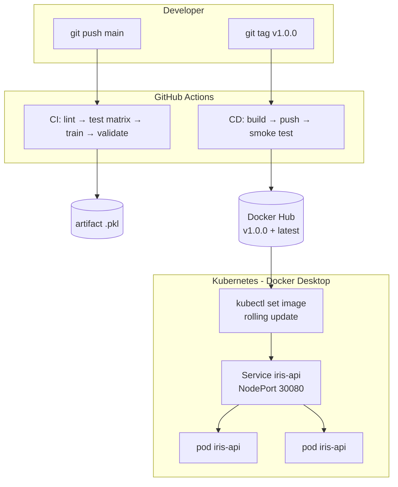

# 🏗️ Arquitetura — Aula 08: Deploy Contínuo de Modelos (CI/CD de ML)

A **Aula 08** fecha o curso conectando três peças: **estratégias de deploy**
(vídeo 8.1), **orquestração no Kubernetes** (8.2) e **pipeline de CI/CD** (8.3).

---

## 🎯 Visão Geral (fluxo completo)



| Workflow | Trigger | Saída |
|----------|---------|-------|
| **CI** | push/PR em `main` | Status verde + artifact `.pkl` |
| **CD** | push de tag `v*` | Imagem publicada no Docker Hub |
| **Deploy** | `kubectl set image` (local/cluster) | Nova versão no ar, sem downtime |

---

## 📁 Estrutura de Diretórios

```
fiap-ml-aula08/
├── Dockerfile                 # imagem que serve a API (gunicorn)
├── requirements.txt           # numpy<2 (sklearn 1.3) + flask + gunicorn + qualidade
├── .github/workflows/
│   ├── ci.yml                 # lint → test → train+validate
│   └── cd.yml                 # build → push → smoke test
├── k8s/
│   ├── deployment.yaml        # 2 réplicas + probes + rolling update
│   ├── service.yaml           # NodePort 30080
│   └── blue-green/            # blue + green + service (switch por selector)
├── src/
│   ├── serve/app.py           # /health /ready /version /predict
│   └── train/{train,validate_model}.py
└── tests/{test_smoke,test_train,test_app}.py
```

---

## 🔌 A API de Inferência

| Endpoint | Método | Papel |
|----------|--------|-------|
| `/health` | GET | **liveness** — processo vivo? (reinicia se falhar) |
| `/ready` | GET | **readiness** — modelo carregou? (tira do tráfego se falhar) |
| `/version` | GET | versão servida (visualizar blue-green/rolling update) |
| `/predict` | POST | inferência: `{"features":[5.1,3.5,1.4,0.2]}` → classe |

> Liveness e readiness apontam pra endpoints **diferentes** de propósito: falha de
> liveness reinicia o container; falha de readiness só o remove do balanceamento.

---

## 🆚 CI/CD ML vs Tradicional

| Aspecto | App web | App de ML |
|---------|---------|-----------|
| Artefato | Imagem Docker | Imagem Docker **com modelo embutido** |
| Validação | Unit/integration tests | + **validate accuracy ≥ threshold** |
| Build | `docker build` | + `python train.py` antes (dentro do build) |
| Tag | Semver normal | Semver + meta de dataset/modelo |
| Rollback | Voltar versão | + reativar modelo anterior no registry/cluster |
| Monitoramento | uptime, latência, 5xx | + drift, distribuição de predições, accuracy |

---

## 🆚 Mapa de Equivalências

| GitHub Actions | Jenkins | GitLab CI |
|----------------|---------|-----------|
| Workflow | Pipeline | Pipeline |
| Job | Stage | Stage |
| Step | Step | Script line |
| `uses: actions/X` | Plugin | Include template |
| `needs:` | `depends on` | `needs:` |
| `secrets.X` | Credentials | CI/CD Variables |

| Docker solto | Kubernetes |
|--------------|------------|
| `docker run` | Deployment (réplicas) |
| load balancer manual | Service (selector) |
| `docker ps` + fé | readiness/liveness probes |
| reiniciar na mão | self-healing (ReplicaSet) |
| `docker run` N vezes | `kubectl scale` / HPA |

---

## 🧱 Decisões de Design

### 1. Treino dentro do Dockerfile
Garante imagem **autocontida e reproduzível**; o build falha se o modelo reprovar.
Para projetos grandes, treino fica fora e o modelo entra via download/COPY.

### 2. `validate_model.py` separado do treino
Permite usar como **quality gate** em qualquer ponto (CI, build, Airflow).

### 3. Imagem local no Kubernetes (Docker Desktop)
O cluster compartilha o daemon do Docker → `imagePullPolicy: IfNotPresent` usa a
imagem buildada localmente, sem precisar de registry para a aula.

### 4. Tag de versão dispara o CD
Push de código não publica; só `git tag v1.0.0`. Evita publicação acidental.

### 5. `latest` + tag imutável
`latest` aponta pro último; `v1.0.0` é imutável e auditável. Deploy fixa a imutável.

### 6. `maxUnavailable: 0` no rolling update
Pod novo só recebe tráfego após readiness; antigo só morre depois. **Downtime zero.**

### 7. Cache de pip (CI) e de layers (CD via GHA)
Builds bem mais rápidos. Chave automática por hash do `requirements.txt`.

---

## 🔐 Secrets Necessários

| Secret | Para que serve |
|--------|----------------|
| `DOCKERHUB_USERNAME` | Login no Docker Hub |
| `DOCKERHUB_TOKEN` | Token (Read+Write) com permissão de push |

> ⚠️ **NUNCA** commite secrets. Sempre via `${{ secrets.NOME }}`.

---

## 🎉 Fechamento do Curso

| Aula | Onde aparece na Aula 08 |
|------|--------------------------|
| 01 - Introdução ao Pipeline de ML | Código base testado no CI |
| 02 - Ingestão de Dados e Feature Engineering | Lint/format aplicado |
| 03 - Treinamento de Modelos e Validação | `train.py` chamado no CI e no build |
| 04 - Deploy de Modelos (Implantação Inicial) | A API `src/serve/app.py` evolui pra cá |
| 05 - Orquestração de Pipelines com Airflow | DAG poderia disparar CI/deploy |
| 06 - Reprodutibilidade e Qualidade do Código | Validação de dado/modelo no quality gate |
| 07 - Treinamento Automático e Re-Treino de Modelos | Drift → re-treino → nova versão → deploy |
| 08 - **Deploy Contínuo de Modelos (CI/CD de ML)** | **Amarrando tudo** |

**Você completou o curso de MLOps. 🚀**
