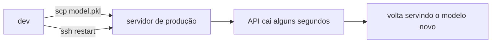
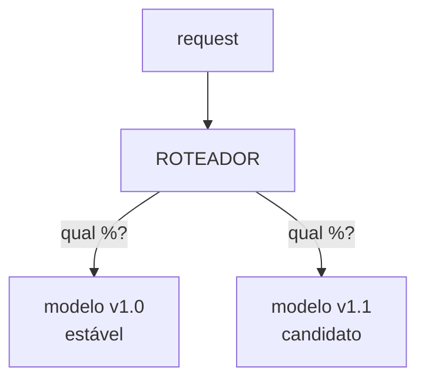
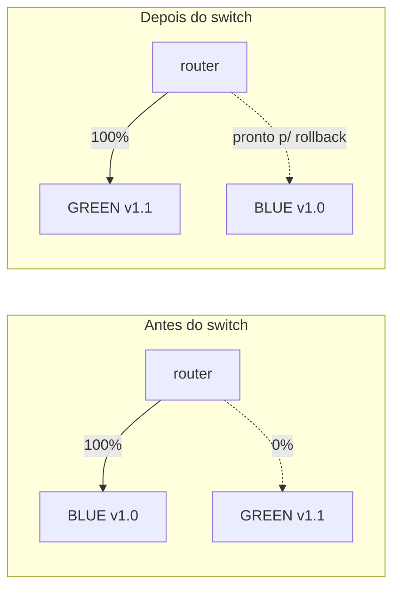
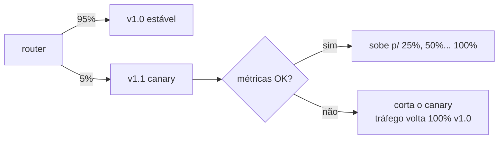

# 🎬 Vídeo 8.1 - DevOps para ML e Estratégias de Deploy

**Aula**: 8 - Deploy Contínuo de Modelos (CI/CD de ML)  
**Vídeo**: 8.1  
**Temas**: Risco do deploy manual; Deploy contínuo; Roteamento de tráfego; Blue-Green; Monitoramento em produção

---

## 🚀 Sobre Este Vídeo

> **"Em 7 aulas a gente treinou, versionou e re-treinou modelo. Hoje a pergunta muda: como troca o modelo em produção SEM derrubar quem está usando?"**

Este vídeo é **conceitual**. Ele estabelece o vocabulário de deploy que os vídeos
8.2 (Kubernetes) e 8.3 (CI/CD) vão colocar a mão na massa.

| Etapa | Descrição |
|-------|-----------|
| **Risco do manual** | Por que trocar o `.pkl` na mão e reiniciar é arriscado |
| **Deploy contínuo** | Pipeline assume a troca; humano sai do caminho crítico |
| **Roteamento de tráfego** | Quem decide qual request vai pra qual versão |
| **Blue-Green / Canary** | Duas estratégias de troca sem downtime |
| **Monitoramento** | Como saber que a nova versão é pior ANTES do cliente reclamar |

### Pré-requisitos

| Requisito | Como verificar |
|-----------|----------------|
| Aula 07 concluída | Re-treino automático funcionando |
| Docker instalado | `docker --version` |
| Docker funcionando (p/ a demo opcional) | `docker ps` sem erro |

---

## 📚 Parte 1: O Risco de Atualizar Modelo na Mão

### Passo 1: O Fluxo Manual

A forma manual de colocar um modelo novo no ar:



O que pode dar errado nesse fluxo:

| Problema | Consequência |
|----------|--------------|
| API reinicia | **Downtime**: requests caem durante o restart |
| `.pkl` antigo foi sobrescrito | **Sem rollback rápido** se o novo for pior |
| Sem validação antes | Modelo ruim vai direto pro cliente |
| Passo manual | **Não reproduzível**: "funcionou na máquina do João" |
| Sem registro | Ninguém sabe qual versão está no ar agora |

> 💡 **Ponto-chave**: o problema não é o modelo — é o **processo de troca**. Em ML
> o estrago é pior porque a regressão é **silenciosa**: a API responde `200 OK`, só
> que prevendo errado.

---

### Passo 2: O Que "Bom" Parece

Um deploy saudável de modelo tem cinco propriedades:

| Propriedade | Significa |
|-------------|-----------|
| **Sem downtime** | Versão nova sobe ao lado da antiga; tráfego migra gradual |
| **Validado** | Modelo só entra se passou no quality gate (accuracy ≥ threshold) |
| **Rollback rápido** | Voltar pra versão anterior é um comando, não um deploy novo |
| **Versionado** | Cada imagem tem tag imutável (`v1.2.0`); dá pra auditar |
| **Observável** | Métricas de saúde e de qualidade visíveis em tempo real |

Os vídeos seguintes entregam isso: **8.2** dá o "sem downtime + rollback"
(Kubernetes), **8.3** dá o "validado + versionado" (CI/CD).

---

## 📚 Parte 2: Roteamento de Tráfego

### Passo 3: Quem Decide Pra Onde Vai o Request

Trocar de modelo sem downtime depende de uma peça: **algo na frente das réplicas
que decide qual versão recebe cada request** (Service/Ingress no Kubernetes, load
balancer, service mesh).



Mudando a regra do roteador, você implementa diferentes **estratégias de deploy**.

---

### Passo 4: Blue-Green Deployment

Duas cópias completas do ambiente: **Blue** (atual) e **Green** (nova). O roteador
aponta 100% pra uma de cada vez.



| Vantagem | Custo |
|----------|-------|
| Switch instantâneo (1 comando) | Precisa do **dobro de recurso** durante a troca |
| Rollback instantâneo (switch de volta) | Migração de schema/estado tem que ser compatível |
| Green é testado **com tráfego interno** antes do switch | — |

> 🔍 **Nos bastidores**: o switch é uma troca de **selector** no roteador, não um
> restart. No Kubernetes é literalmente mudar o `selector` do Service de `blue` para
> `green` — atômico: requests em voo terminam no pod antigo, os novos já caem no novo.

---

### Passo 5: Canary (a evolução natural)

Em vez de 0% → 100% de uma vez, o canary libera a versão nova pra uma **fatia
pequena** e cresce conforme as métricas seguram.



| Blue-Green | Canary |
|------------|--------|
| Troca tudo de uma vez | Troca em fatias crescentes |
| Exposição: 0% ou 100% | Exposição controlada (atinge poucos usuários) |
| Mais simples | Mais seguro, exige métricas automáticas |

> 💡 **Ponto-chave**: Blue-Green responde *"a versão nova funciona?"*. Canary
> responde *"a versão nova é melhor, no tráfego real, sem arriscar todo mundo?"*.

---

## 📚 Parte 3: Monitoramento em Produção

### Passo 6: Dois Níveis de Saúde

Modelo em produção tem **duas** perguntas de saúde, não uma:

| Nível | Pergunta | Como medir |
|-------|----------|------------|
| **Saúde de sistema** | A API está de pé e respondendo? | latência, erro 5xx, CPU/memória, probes |
| **Saúde de modelo** | As previsões continuam boas? | distribuição das predições, drift, accuracy quando o label chega |

> 💡 **Ponto-chave**: a API pode estar `200 OK` (sistema perfeito) e o modelo estar
> **errado** (qualidade péssima). Esse é o risco específico de ML — monitorar só
> uptime não basta.

### Passo 7: Sinais que Disparam Rollback

| Sinal | Camada | Ação típica |
|-------|--------|-------------|
| Erro 5xx subiu | Sistema | Rollback automático |
| Latência p99 estourou | Sistema | Rollback / scale up |
| Distribuição de predições mudou | Modelo | Alerta + investigar drift |
| Accuracy caiu (quando label chega) | Modelo | Rollback + re-treino (Aula 07) |

O re-treino automático da Aula 07 (`drift_gate` + DAG `retrain_automatic`) fecha o
laço: drift → re-treino → nova versão → deploy (vídeos 8.2/8.3) → monitorar de novo.

---

## 🧪 Parte 4: Ver as Duas Versões Coexistindo (local)

> ⚠️ **TEMPORÁRIO / DEMONSTRAÇÃO**: dois containers locais só para ver Blue e Green
> no ar ao mesmo tempo — o **pré-requisito** do blue-green. O **switch de verdade**
> (um endereço fixo cujo backend troca) precisa de um roteador e está no vídeo 8.2,
> com Kubernetes. Derrube ao final (Passo 9).

### Passo 8: Gerar a Imagem e Subir Blue e Green Lado a Lado

Pré-requisito: o repositório clonado (já tem o `Dockerfile`). Geramos a imagem aqui
mesmo — o build treina e valida o modelo dentro dele (o `Dockerfile` é detalhado no 8.3).

**Linux/Mac e Windows:**
```bash
# 1. Gerar a imagem da API (usa o Dockerfile do repo)
docker build -t fiap-ml-iris:1.0.0 .

# 2. Blue e Green a partir da MESMA imagem, mudando só o rótulo de versão (-e APP_VERSION) e a porta.
#    Aqui é só para ilustrar a coexistência; no 8.2 a green será um build de verdade diferente.
docker run -d --name blue  -p 5001:5001 -e APP_VERSION=1.0.0 fiap-ml-iris:1.0.0
docker run -d --name green -p 5002:5001 -e APP_VERSION=2.0.0 fiap-ml-iris:1.0.0
```

```bash
curl -s localhost:5001/version    # Blue  -> {"version":"1.0.0",...}
curl -s localhost:5002/version    # Green -> {"version":"2.0.0",...}

# Validar o Green com tráfego de teste ANTES de promover
curl -s -X POST localhost:5002/predict \
  -H 'Content-Type: application/json' -d '{"features":[5.1,3.5,1.4,0.2]}'
```

> 💡 **Ponto-chave**: aqui as duas versões estão no ar, mas cada uma na sua porta.
> Isso **não é** o switch — é só a coexistência. O switch é o roteador manter **um
> endereço só** e trocar para qual versão ele aponta, sem o cliente saber. Isso a
> gente faz de verdade no 8.2 (trocando o `selector` do Service no Kubernetes).

### Passo 9: Derrubar a Demo (reverter)

**Linux/Mac e Windows:**
```bash
docker rm -f blue green
```

✅ Demo encerrada. No próximo vídeo o switch acontece de verdade no Kubernetes.

---

## 🔧 Troubleshooting

| Sintoma | Causa | Solução |
|---------|-------|---------|
| `docker: image not found` | Build não rodou | Rode o `docker build -t fiap-ml-iris:1.0.0 .` do Passo 8 |
| Porta 5001 ocupada | Outro container subiu antes | `docker rm -f $(docker ps -q --filter publish=5001)` |
| "Blue-green é igual canary?" | Confusão comum | Blue-green = 0%/100%; canary = fatias crescentes |
| "Por que não só reiniciar?" | Visão de software stateless | Restart = downtime + sem rollback; o ponto da aula é evitar isso |

---

**FIM DO VÍDEO 8.1** ✅

> Próximo (**8.2**): saímos do "container solto" e colocamos a API num **cluster
> Kubernetes**, com réplicas, probes, rolling update e o **switch blue-green real**
> (trocando o `selector` do Service) — o "sem downtime" virando código.
