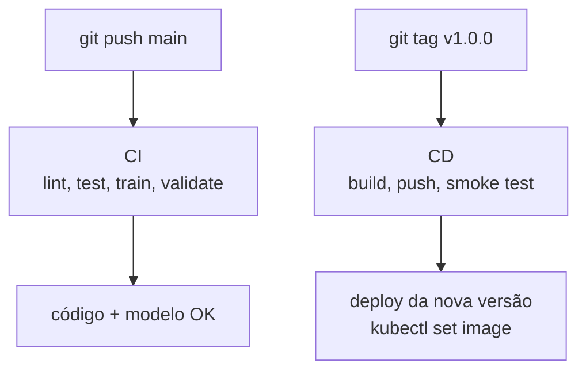

# 🎬 Vídeo 8.3 - Pipeline de CI/CD para Modelos

**Aula**: 8 - Deploy Contínuo de Modelos (CI/CD de ML)  
**Vídeo**: 8.3  
**Temas**: GitHub Actions; CI (lint+test+validate); CD (build+push); Secrets; Smoke test; Deploy da nova versão

---

## 🚀 Sobre Este Vídeo

> **"No 8.2 a gente buildou e trocou a imagem na mão. Hoje o pipeline faz isso: cada push valida, cada tag publica e dispara o deploy da nova versão."**

Amarramos o curso inteiro: o **CI** garante que código + modelo estão bons; o **CD**
empacota numa imagem versionada e a leva pro deploy (o mesmo `kubectl set image`
do vídeo 8.2, agora orquestrado).

| Etapa | Descrição |
|-------|-----------|
| **CI** | lint → test (matrix) → train + validate → artifact |
| **Secrets** | credenciais do registry, nunca em código |
| **CD** | build → push (Docker Hub) → smoke test |
| **Deploy** | `kubectl set image` da nova versão (local, contra o cluster do 8.2) |

### Pré-requisitos

| Requisito | Como verificar |
|-----------|----------------|
| Vídeo 8.2 concluído | API rodando no Kubernetes |
| Repositório no GitHub | `git remote -v` |
| Conta Docker Hub | https://hub.docker.com |

---

## 📚 Parte 1: O Pipeline em Dois Workflows

### Passo 1: CI vs CD



| | CI (`ci.yml`) | CD (`cd.yml`) |
|--|--------------|---------------|
| **Trigger** | push / PR em `main` | tag `v*` ou manual |
| **Pergunta** | "está bom?" | "publica e sobe" |
| **Saída** | status verde + artifact `.pkl` | imagem versionada no registry |

> 💡 **Ponto-chave**: push de código **não publica imagem**. Só uma **tag explícita**
> (`v1.0.0`) dispara o CD. Isso evita publicação acidental a cada commit.

---

## ⚙️ Parte 2: CI — Integração Contínua

### Passo 2: O Workflow de CI

`.github/workflows/ci.yml` tem três jobs encadeados por `needs:`:

```yaml
name: CI

on:
  push:
    branches: [main]
  pull_request:
    branches: [main]

jobs:
  lint:
    runs-on: ubuntu-latest
    steps:
      - uses: actions/checkout@v4
      - uses: actions/setup-python@v5
        with:
          python-version: '3.10'
          cache: 'pip'
      - run: pip install flake8 black
      - name: Lint with flake8
        run: flake8 src tests
      - name: Format check with black
        run: black --check src tests

  test:
    runs-on: ubuntu-latest
    needs: lint
    strategy:
      fail-fast: false
      matrix:
        python-version: ['3.9', '3.10', '3.11']
    steps:
      - uses: actions/checkout@v4
      - uses: actions/setup-python@v5
        with:
          python-version: ${{ matrix.python-version }}
          cache: 'pip'
      - run: pip install -r requirements.txt
      - name: Pytest com coverage
        run: pytest tests/ -v --cov=src --cov-report=xml --cov-report=term
      - name: Upload coverage
        if: matrix.python-version == '3.10'
        uses: codecov/codecov-action@v3
        with:
          file: ./coverage.xml
          fail_ci_if_error: false

  train-and-validate:
    runs-on: ubuntu-latest
    needs: test
    steps:
      - uses: actions/checkout@v4
      - uses: actions/setup-python@v5
        with:
          python-version: '3.10'
          cache: 'pip'
      - run: pip install -r requirements.txt
      - name: Train model
        run: python src/train/train.py
      - name: Validate accuracy
        run: python src/train/validate_model.py
      - name: Upload model artifact
        uses: actions/upload-artifact@v4
        with:
          name: trained-model
          path: models/model.pkl
          retention-days: 7
```

> 🔍 **Nos bastidores — matrix**: o job `test` roda 3x em paralelo (3.9/3.10/3.11).
> `fail-fast: false` evita que a falha de uma versão **cancele** as outras; o
> `if: matrix.python-version == '3.10'` no coverage evita subir o relatório 3 vezes.

> 🔍 **Nos bastidores — cache de pip**: `cache: 'pip'` guarda os wheels com chave no
> hash do `requirements.txt`. Deps não mudaram → reaproveita o download; mudaram →
> refaz a chave sozinho.

> 🔍 **Nos bastidores — artifacts**: jobs rodam em máquinas diferentes e não
> compartilham disco. `upload-artifact`/`download-artifact` é o jeito de **passar o
> `.pkl` entre jobs**; `retention-days` evita acúmulo.

### Passo 3: Rodar o CI Localmente (antes de empurrar)

O CI não tem segredo: são os mesmos comandos que você roda local. Reproduza:

**Linux/Mac e Windows:**
```bash
flake8 src tests
black --check src tests
pytest tests/ -v --cov=src --cov-report=term
python src/train/train.py && python src/train/validate_model.py
```

**Resultado esperado:** tudo verde, `✅ Modelo aprovado`.

> 💡 **Ponto-chave**: se passa local com os **mesmos comandos**, passa no CI. A
> regra de ouro é o workflow não inventar comando que você não consegue rodar na
> sua máquina.

---

## 🔑 Parte 3: Secrets

### Passo 4: Token do Docker Hub

**No Docker Hub:**
1. Login em https://hub.docker.com
2. Account Settings → Security → **New Access Token**
3. Nome: `github-actions-fiap` | Permissões: **Read, Write**
4. **Copie o token** (só aparece uma vez)

### Passo 5: Cadastrar os Secrets no Repo

**No GitHub:** Repo → Settings → Secrets and variables → Actions → **New repository secret**

| Secret | Conteúdo |
|--------|----------|
| `DOCKERHUB_USERNAME` | seu usuário do Docker Hub |
| `DOCKERHUB_TOKEN` | o token gerado (`dckr_pat_...`) |

> ⚠️ **NUNCA** escreva o token em código ou no YAML. Use sempre `${{ secrets.NOME }}`.
> O GitHub **mascara** valores de secrets nos logs, mas isso não cobre `echo $TOKEN`
> que você mesmo imprima de formas indiretas — simplesmente não imprima.

> 🔍 **Nos bastidores**: token tem **escopo e revogação** próprios — vazou, revoga
> só ele, sem mexer na senha da conta. Dê só Read/Write (sem Delete). Em cloud, o
> ideal vai além: **OIDC** (`permissions: id-token: write`) com credencial de curta
> duração, sem secret permanente.

---

## 🐳 Parte 4: CD — Entrega Contínua

### Passo 6: O Dockerfile (serve a API)

```dockerfile
FROM python:3.10-slim

WORKDIR /app

# 1. Deps primeiro: aproveita o cache de layer enquanto requirements nao muda
COPY requirements.txt .
RUN pip install --no-cache-dir -r requirements.txt

# 2. Codigo
COPY src/ ./src/

# 3. Treina E VALIDA dentro do build -> imagem autocontida e reproduzivel.
#    Se a accuracy cair abaixo do threshold, o build FALHA aqui.
RUN python src/train/train.py && python src/train/validate_model.py

# 4. Metadados de versao (sobrescritos no build/k8s via --build-arg / env)
ARG APP_VERSION=dev
ENV APP_VERSION=${APP_VERSION}
ENV MODEL_PATH=models/model.pkl

# 5. Serve a API de inferencia com gunicorn (2 workers)
EXPOSE 5001
CMD ["gunicorn", "--bind", "0.0.0.0:5001", "--workers", "2", "src.serve.app:app"]
```

> 🔍 **Nos bastidores**: `COPY requirements.txt` + `pip install` vêm **antes** de
> `COPY src/`. Assim, mudar código não invalida a layer de dependências — o
> `pip install`, que é o passo caro, só re-roda quando o `requirements.txt` muda.

### Passo 7: O Workflow de CD

`.github/workflows/cd.yml`:

```yaml
name: CD

on:
  push:
    tags:
      - 'v*'
  workflow_dispatch:

jobs:
  build-and-push:
    runs-on: ubuntu-latest
    permissions:
      contents: read
    steps:
      - uses: actions/checkout@v4
      - name: Set up Docker Buildx
        uses: docker/setup-buildx-action@v3
      - name: Login to Docker Hub
        uses: docker/login-action@v3
        with:
          username: ${{ secrets.DOCKERHUB_USERNAME }}
          password: ${{ secrets.DOCKERHUB_TOKEN }}
      - name: Extract metadata
        id: meta
        uses: docker/metadata-action@v5
        with:
          images: ${{ secrets.DOCKERHUB_USERNAME }}/fiap-ml-cicd
          tags: |
            type=ref,event=tag
            type=raw,value=latest
      - name: Build and push
        uses: docker/build-push-action@v5
        with:
          context: .
          push: true
          tags: ${{ steps.meta.outputs.tags }}
          labels: ${{ steps.meta.outputs.labels }}
          build-args: |
            APP_VERSION=${{ github.ref_name }}
          cache-from: type=gha
          cache-to: type=gha,mode=max

  smoke-test:
    runs-on: ubuntu-latest
    needs: build-and-push
    steps:
      - name: Sobe a imagem publicada
        run: |
          IMAGE=${{ secrets.DOCKERHUB_USERNAME }}/fiap-ml-cicd:latest
          docker pull "$IMAGE"
          docker run -d --name smoke -p 5001:5001 "$IMAGE"
      - name: Espera readiness
        run: |
          for i in $(seq 1 15); do
            if curl -sf localhost:5001/ready; then echo " -> ready"; exit 0; fi
            sleep 2
          done
          echo "❌ container nao ficou ready"; docker logs smoke; exit 1
      - name: Testa /predict
        run: |
          OUT=$(curl -sf -X POST localhost:5001/predict \
            -H 'Content-Type: application/json' -d '{"features":[5.1,3.5,1.4,0.2]}')
          echo "Resposta: $OUT"
          echo "$OUT" | grep -q '"label"' || { echo "❌ smoke test falhou"; exit 1; }
          echo "✅ Smoke test OK"
      - name: Limpa
        if: always()
        run: docker rm -f smoke || true
```

> 🔍 **Nos bastidores — cache de layers**: `cache-from/to: type=gha` guarda as
> **layers** do build no cache do Actions. No próximo build, layers intactas (ex.: o
> `pip install`) são restauradas em vez de refeitas — corta minutos do CD.

> 🔍 **Nos bastidores — tags imutáveis**: o `metadata-action` gera `v1.0.0`
> (imutável, auditável) e `latest` (ponteiro móvel). Deploy de produção fixa a
> **imutável** — com `latest` não dá pra auditar o que está no ar.

> 🔍 **Nos bastidores — permissions**: `permissions: contents: read` é **menor
> privilégio** — o `GITHUB_TOKEN` do job só lê o repo. Amplia (`contents: write`,
> `id-token: write`) só quando o workflow precisar publicar release ou usar OIDC.

### Passo 8: Disparar o CD com uma Tag

**Linux/Mac e Windows:**
```bash
git add .
git commit -m "feat: API de inferencia + k8s + pipeline CI/CD"
git push origin main

git tag v1.0.0
git push origin v1.0.0
```

**Resultado esperado** na aba Actions:
```
✅ CD
   ✅ build-and-push    -> pushed SEU-USER/fiap-ml-cicd:v1.0.0 + :latest
   ✅ smoke-test        -> ✅ Smoke test OK
```

E no Docker Hub: tags `v1.0.0` e `latest`.

---

## 🚀 Parte 5: Deploy da Nova Versão

> O runner do GitHub **não alcança** o cluster local do Docker Desktop. Então o
> deploy roda **localmente**, consumindo a imagem que o CD publicou. Em produção
> (cluster acessível / self-hosted runner) isso vira um job no `cd.yml` — veja o
> bloco comentado `deploy:` no fim do arquivo.

### Passo 9: Apontar o Deployment pra Imagem do Registry

Edite `k8s/deployment.yaml` trocando a imagem local pela publicada:

```yaml
# de:
image: fiap-ml-iris:1.0.0
# para:
image: SEU-USUARIO/fiap-ml-cicd:v1.0.0
imagePullPolicy: IfNotPresent
```

Aplique e suba a nova versão (mesmo fluxo do vídeo 8.2):

**Linux/Mac e Windows:**
```bash
kubectl --context docker-desktop apply -f k8s/
kubectl --context docker-desktop set image deployment/iris-api \
  iris-api=SEU-USUARIO/fiap-ml-cicd:v1.0.0
kubectl --context docker-desktop rollout status deployment/iris-api --timeout=120s
curl -s localhost:30080/version
```

> 🔍 **Nos bastidores**: se o smoke test pós-deploy reprovar, o rollback é
> `kubectl rollout undo deployment/iris-api` — instantâneo, porque o ReplicaSet
> anterior segue registrado. A regra: toda automação de deploy precisa de um caminho
> de volta tão rápido quanto o de ida.

✅ Versão publicada pelo CD rodando no cluster.

---

## 🧪 Parte 6: Demonstração — Forçar o CI a Falhar

> ⚠️ **TEMPORÁRIO / DEMONSTRAÇÃO**: o objetivo é ver o quality gate barrando.
> **Reverta no Passo 11.**

### Passo 10: Baixar o Threshold pra Reprovar (ou quebrar um teste)

Edite `src/train/validate_model.py` e force a reprovação:

```python
MIN_ACCURACY = 0.999  # ⚠️ TEMPORÁRIO: threshold impossível, só pra ver o CI vermelho
```

```bash
git commit -am "test: forca CI a falhar (TEMPORARIO)"
git push origin main
```

**Resultado esperado:** job `train-and-validate` falha com
`❌ Modelo abaixo do threshold` e o badge fica **failing**.

### Passo 11: Reverter

**Linux/Mac e Windows:**
```bash
git revert HEAD --no-edit
git push origin main
```

Ou edite de volta para `MIN_ACCURACY = 0.85`. Confirme o CI verde de novo.

✅ Quality gate demonstrado e revertido.

---

## 📦 Arquivos de Referência (versão final)

- **`.github/workflows/ci.yml`** — Passo 2 (versão final, sem trechos temporários).
- **`.github/workflows/cd.yml`** — Passo 7 (versão final). O bloco `deploy:` fica
  comentado de propósito: só se aplica a cluster acessível pelo runner.
- **`Dockerfile`** — Passo 6 (versão final).
- **`k8s/deployment.yaml` / `k8s/service.yaml`** — vídeo 8.2. No deploy real, troque
  o `image` pela tag publicada (Passo 9).

> ⚠️ O `MIN_ACCURACY = 0.999` do Passo 10 é **temporário**. A versão final é `0.85`.

---

## 🔧 Troubleshooting

| Erro | Causa | Solução |
|------|-------|---------|
| `denied: requested access to the resource is denied` | Token errado / sem permissão | Conferir `DOCKERHUB_TOKEN` (Read+Write) |
| `failed to solve: failed to load cache` | Cache GHA indisponível | Re-rodar; ou remover `cache-from/to` |
| Tag não dispara o CD | Push sem a tag | `git push origin v1.0.0` (a tag, não só `main`) |
| Smoke test não fica ready | App demora a subir | Aumentar o loop de espera; ver `docker logs smoke` |
| `ErrImagePull` no k8s após deploy | Tag publicada não bate | Conferir nome/tag exatos no `set image` |
| CI verde local, vermelho no GitHub | Versão de Python diferente | Reproduzir com a versão da matrix que falhou |

---

**FIM DO VÍDEO 8.3** ✅

---

## 🏆 Recapitulação da Aula 08

| Vídeo | Tópico | O que entregou |
|-------|--------|----------------|
| **8.1** | DevOps para ML e Estratégias de Deploy | Risco do manual, roteamento, Blue-Green/Canary, monitoramento |
| **8.2** | Orquestração com Kubernetes | Deployment, Service, probes, self-healing, scaling, rolling update |
| **8.3** | Pipeline de CI/CD para Modelos | CI (lint+test+validate), CD (build+push+smoke), deploy da nova versão |

## 🎉 Fim do Curso!

| Aula | Tema |
|------|------|
| **01** | Introdução ao Pipeline de ML |
| **02** | Ingestão de Dados e Feature Engineering |
| **03** | Treinamento de Modelos e Validação |
| **04** | Deploy de Modelos (Implantação Inicial) |
| **05** | Orquestração de Pipelines com Airflow |
| **06** | Reprodutibilidade e Qualidade do Código |
| **07** | Treinamento Automático e Re-Treino de Modelos |
| **08** | **Deploy Contínuo de Modelos (CI/CD de ML)** ⬅️ você está aqui |

**Você tem agora um pipeline MLOps de ponta a ponta: do dado ao deploy versionado em cluster. 🚀**
